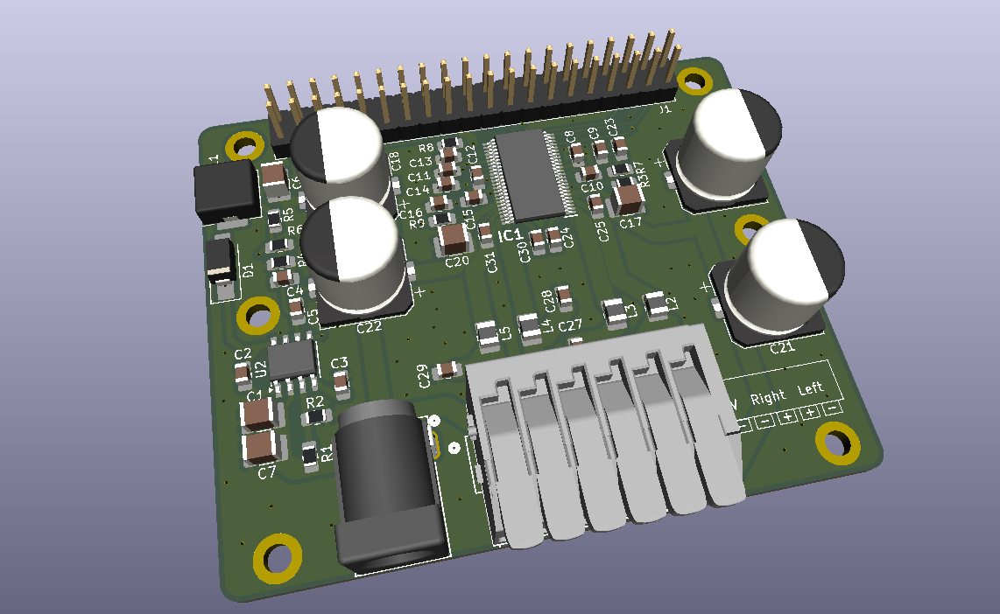

# Smart Stereo

A small, power-efficient AirPlay 2 network amplifier. A custom stereo class-D amplifier HAT sits on a Radxa Zero 3E running NixOS and `shairport-sync`, so any Apple device (or anything that speaks AirPlay 2) can stream straight to a pair of passive speakers over Ethernet.



## How it works

```
 iPhone / Mac ──AirPlay 2──▶ Ethernet ──▶ Radxa Zero 3E (NixOS, shairport-sync)
                                              │  I2S (pins 12, 35, 38, 40)
                                              │  I2C (pins 3, 5)
                                              ▼
 12–24 V DC ──▶ HAT ──▶ TPS54232 buck ──5 V──▶ SBC (via header pins 2/4)
                 │                      SBC 3.3 V ──▶ TAS5756M logic
                 └──────────── VIN ───▶ TAS5756M power stage ──▶ L / R speakers
```

- **SBC:** [Radxa Zero 3E](https://radxa.com/products/zeros/zero3e/). Small, low power, and has wired Ethernet. Any SBC with a Raspberry Pi-style 40-pin header and an I2S interface on the standard pins should work.
- **Amplifier:** TI [TAS5756M](https://www.ti.com/product/TAS5756M), a stereo I2S-input class-D amp with a built-in DAC and DSP. It receives audio over I2S and is configured over I2C.
- **Power:** one 12–24 V DC input feeds the amplifier directly. A TI [TPS54232](https://www.ti.com/product/TPS54232) buck converter makes 5 V for the SBC, so you need only one power supply. The 3.3 V for the amplifier's logic comes back from the SBC's own regulator.
- **Software:** NixOS, configured declaratively, so the same config can be copied to any number of speakers. `shairport-sync` is built with AirPlay 2 support, and `nqptp` handles AirPlay 2 timing.

The HAT is pin-compatible with the [HiFiBerry Amp2](https://www.hifiberry.com/shop/boards/hifiberry-amp2/), so it also works on a Raspberry Pi with the HiFiBerry drivers.

> [!IMPORTANT] 
> **!!IMPORTANT!! USING A SELF ASSEMBLED HAT WITH A RADXA AND NIXOS IS SOMEWHAT UNCONVENTIONAL. IF YOU USE ANY OTHER SETUP I CANNOT OFFER SUPPORT. THIS IS A HOBBY PROJECT, NOT A PRODUCT.**

## Repository layout

| Path | What it is |
| --- | --- |
| `kicad/` | KiCad 10 project for the HAT: schematics, PCB, custom symbols, footprints and 3D models |
| `kicad/bom/ibom.html` | Interactive BOM. Open it in a browser while placing parts |
| `kicad/datasheets/` | Datasheets for the TAS5756M and TPS54232 |
| `kicad/fabrication-toolkit-options.json` | Settings for the KiCad Fabrication Toolkit plugin (Gerbers, BOM, placement files) |
| `nix/configuration.nix` | Base NixOS system config |
| `nix/audio-hat.nix` | Device tree overlay that enables I2S, I2C and the TAS5756M sound card |
| `nix/airplay.nix` | `shairport-sync` (AirPlay 2), `nqptp` and Avahi |
| `imgs/` | Render and schematic exports used in this README |

## Hardware

### Schematics

| Sheet | |
| --- | --- |
| Top level / amplifier | [imgs/stereo.svg](imgs/stereo.svg) |
| 5 V power supply | [imgs/power.svg](imgs/power.svg) |
| SBC header and connectors | [imgs/io.svg](imgs/io.svg) |

### 40-pin header

Only these header pins are used. Everything else is left unconnected.

| Pin | Net | Purpose |
| --- | --- | --- |
| 1, 17 | 3.3V | Logic supply for the TAS5756M, from the SBC |
| 2, 4 | 5V | **Output** from the HAT's buck converter, powers the SBC |
| 3 | SDA | I2C data |
| 5 | SCL | I2C clock |
| 7 | SPK_MUTE | Amplifier mute (drive **high** to play) |
| 12 | SCLK | I2S bit clock |
| 35 | LRCK/FS | I2S word clock |
| 38 | ICSDOUT | I2S data from amp to SBC |
| 40 | ICSDIN | I2S data from SBC to amp |
| 6, 9, 14, 20, 25, 30, 34, 39 | GND | Ground |


### Building the board

1. Open `kicad/stereo.kicad_pro` in KiCad 10.
2. Generate fabrication files. The easiest way is the [Fabrication Toolkit](https://github.com/bennymeg/Fabrication-Toolkit) plugin (its settings are in `kicad/fabrication-toolkit-options.json`). It writes Gerbers, drill files, a BOM and a placement file to `kicad/production/`.
3. Order the PCB (2 layers, 1.6 mm), and optionally SMT assembly. Most passives are 0805 / 1210 with hand-solder pads, so hand assembly is practical too. The TAS5756M (TSSOP-48 with thermal pad) and TPS54232 (SO-8 PowerPAD) need their thermal pads soldered, so hot air or a reflow plate is recommended for those two.
4. Use `kicad/bom/ibom.html` to place the parts.


### Before first power-up

- Check for shorts between VIN, 5V, 3.3V and GND with a multimeter.
- Power the HAT alone first and confirm about 5 V on header pin 2 before plugging in the SBC.
- **Do not** power the SBC over USB-C while the HAT is powered. The HAT already feeds 5 V into the header.
- The speaker outputs are bridge-tied (BTL). Never connect a speaker's − terminal to ground, and never bridge the L and R − terminals.
- Use passive speakers rated for 4–8 Ω.

## Software (NixOS on the Radxa Zero 3E)

### 1. Install NixOS

Get a working aarch64 NixOS install booting on the Radxa Zero 3E with Ethernet up. Then generate the hardware config on the device:

```bash
sudo nixos-generate-config
```

This creates `/etc/nixos/hardware-configuration.nix`, which `configuration.nix` imports. It is specific to each device and not part of this repo.

### 2. Add the config from this repo

Copy the three files from `nix/` into `/etc/nixos/` on the device, then edit them:

- **`configuration.nix`:** add your SSH public key to `users.users.nixos.openssh.authorizedKeys.keys`, and set `networking.hostName` and `time.timeZone`.
- **`airplay.nix`:** change `"Name of Stereo"` to the name you want to see in the AirPlay menu. If you build several speakers, give each one a unique name and hostname.

Then build and switch:

```bash
sudo nixos-rebuild switch
```

Reboot once so the device tree overlay is loaded.

### What the config does

- **`audio-hat.nix`** adds a device tree overlay that:
  - enables the RK3566 `i2s3` controller on header pins 12 / 35 / 38 / 40;
  - enables `i2c3` on pins 3 / 5 and declares the TAS5756M at **both** possible I2C addresses (`0x4c` and `0x4d`), so the board works whatever the address strap is set to;
  - creates a sound card named `TAS5756M`, so the ALSA device is always `hw:TAS5756M`;
  - disables HDMI audio;
  - holds `GPIO3_C4` (header pin 7, `SPK_MUTE`) high, so the amplifier is unmuted at boot.

  It also loads the `snd_soc_pcm512x` driver, which supports the TAS5756M.
- **`airplay.nix`** builds `shairport-sync` with AirPlay 2 enabled, runs `nqptp` for AirPlay 2 timing, enables Avahi (mDNS) so the speaker shows up on your network, and trusts the `end0` Ethernet interface in the firewall.

### 3. Check it works

```bash
# The TAS5756M should be bound to its driver (shows "UU" at 4c or 4d)
i2cdetect -l
sudo i2cdetect -y <bus number of i2c3>

# The sound card should be listed
aplay -l

# Play a test tone on both channels (keep the volume low!)
speaker-test -D hw:TAS5756M -c 2 -t sine

# Follow the AirPlay service logs
journalctl -fu shairport-sync
```

The speaker should now show up in the AirPlay menu of any device on the same network.

## Using a Raspberry Pi instead

Since the HAT is pin-compatible with the HiFiBerry Amp2, a Raspberry Pi can use the HiFiBerry driver. In `/boot/firmware/config.txt`:

```
dtparam=audio=off
dtoverlay=hifiberry-dacplus
gpio=4=op,dh
```

`gpio=4=op,dh` drives header pin 7 (GPIO4) high to unmute the amplifier. On newer Raspberry Pi OS kernels the overlay may be named `hifiberry-dacplus-std`. Then install `shairport-sync` with AirPlay 2 support and point it at the `sndrpihifiberry` card.
